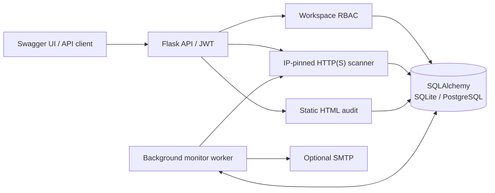

# SiteSentinel — portfolio walkthrough

SiteSentinel is a backend-first website health monitoring **portfolio application**.
It demonstrates Flask REST design, tenant-scoped authorization, persistent
monitoring, incidents and alerts, and website audits. It is not a commercial
monitoring service.

## Architecture



In normal operation, manual checks and site audits are initiated through
authenticated endpoints. The separate worker polls for due checks, stores scan
results, opens/closes incidents, and dispatches optional SMTP notifications.
Access to monitors, incidents, audit history and reports is scoped to a user's
personal workspace or a team workspace they belong to.

## Design decisions worth discussing in an interview

| Decision | Reason | Tradeoff |
| --- | --- | --- |
| App factory + blueprints | Separates authentication, monitoring, workspace, reporting, and documentation APIs | Requires clear route registration and shared conventions |
| SQLAlchemy + Alembic | Database schema is versioned and verified against PostgreSQL in CI | SQLite and PostgreSQL have distinct concurrency semantics |
| JWT access/refresh rotation | Demonstrates session invalidation and replay protection | Requires secure signing keys and token handling |
| Workspace membership/RBAC | Enforces resource boundaries at query/handler level | User/email verification and offboarding need further hardening |
| IP-pinned URL scanner | Reduces DNS rebinding/SSRF risks during redirects | Must still be isolated and egress-restricted in real deployments |
| Lease-backed worker | Avoids simultaneous writes from worker/manual probes | Distributed queue and true request deadlines remain future work |
| Sample-based reporting | Derives metrics from real persisted check rows | Not a duration-weighted uptime SLA |
| Static HTML audit | Offers useful SEO/script evidence without browser automation | Cannot prove analytics events execute or reach endpoints |
| OpenAPI spec + route coverage tests | Reviewer-friendly documentation with drift detection | Schema quality still requires review and examples |

## Where the portfolio demo differs from the real application

```text
Normal application                  Local portfolio showcase
-------------------                 -----------------------
User SQLite or PostgreSQL           Fresh in-memory SQLite only
Real HTTP(S) probes                 Stored, synthetic sample results
Workspace writes permitted          All state changes blocked
Separate background worker          No worker
Optional SMTP                       Explicitly disabled
Deployment environment config       Temporary random JWT signing key
May listen on configured interface  Hard-coded 127.0.0.1 only
```

The portfolio showcase is a **read-only demonstration of the actual persistence,
authorization, reporting and incident state machine**. It does not pretend the
sample URLs were probed live. It is not a safe public hosting recipe.

## Reviewer walkthrough

Use the [local demo instructions](DEMO.md). Sign in through Swagger, authorize
with the short-lived bearer token, examine the overview and response-time trends
for the personal workspace, inspect an open incident and a broken-link audit,
then switch to the team workspace to see a resolved incident.

The data is synthesized once at startup and deleted when the process ends.
No account information is retained.

## Engineering verification

CI checks Python 3.11 and 3.12, Ruff, pytest, PostgreSQL/Alembic migrations,
and OpenAPI operation coverage. Targeted security regression tests cover
authorization after concurrent changes and suppressing alerts to removed
workspace members.

**Security limits:** This portfolio repo is intentionally not positioned as
an unrestricted public SaaS. Before internet-facing deployment it would need
email ownership verification, abuse controls, scanner isolation/time budgets,
network egress restrictions, and robust managed worker operations. See
[security review](SECURITY_REVIEW.md).
